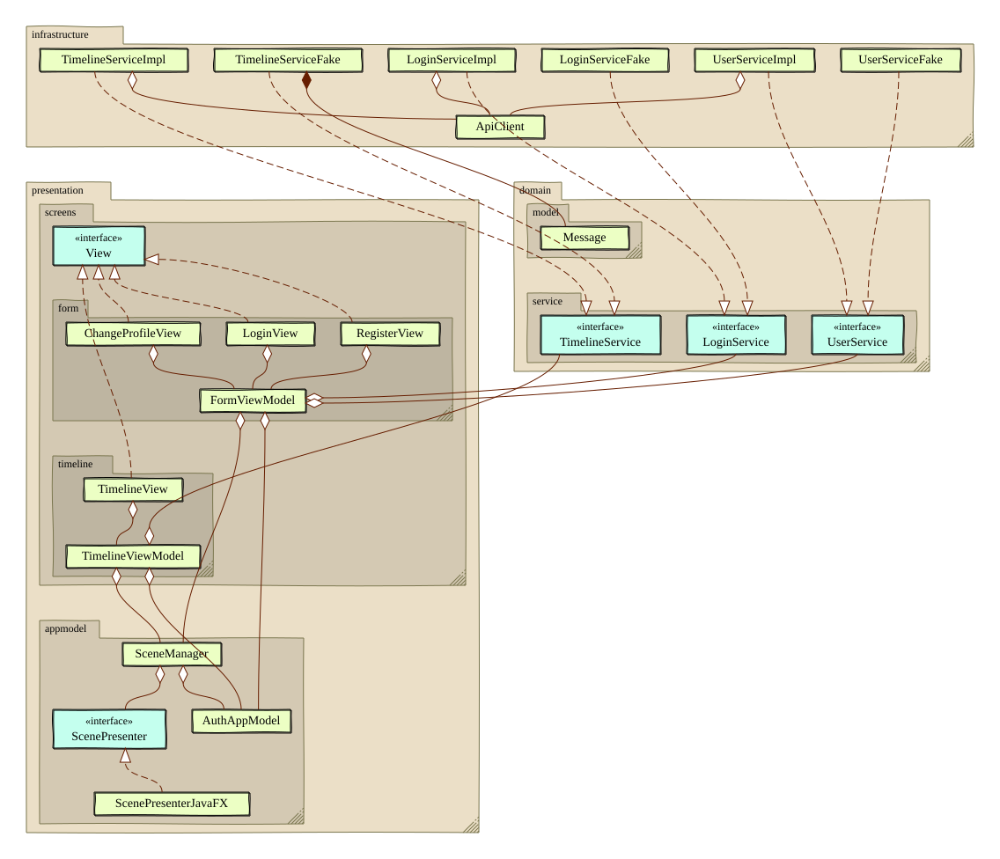

# classdiagram-maven-plugin

A Maven plugin that draws a UML class diagram from your compiled classes.
The output is an SVG image in a hand-drawn style.



## Requirements

- Maven 3.9 or later
- JDK 25 or later to run Maven

The plugin reads class files with the Java Class-File API.
This API needs JDK 25.
Your project itself can target an older Java release.

## Quick Start

Run this command in your project.
Replace `com.example` with your own package.

```
mvn compile com.sosuisha:classdiagram-maven-plugin:1.0.0:generate -Dclassdiagram.package=com.example
```

The diagram is written to `target/classdiagram.svg`.
Open it in a web browser.

## Add the Plugin to Your pom.xml

Add the plugin to your `pom.xml` if you use it often.

```xml
<build>
  <plugins>
    <plugin>
      <groupId>com.sosuisha</groupId>
      <artifactId>classdiagram-maven-plugin</artifactId>
      <version>1.0.0</version>
      <configuration>
        <packageName>com.example</packageName>
        <picturesque>true</picturesque>
      </configuration>
    </plugin>
  </plugins>
</build>
```

Then run this command.

```
mvn compile classdiagram:generate
```

To generate the diagram on every build, add an execution.
The goal runs in the `process-classes` phase by default.

```xml
<executions>
  <execution>
    <goals>
      <goal>generate</goal>
    </goals>
  </execution>
</executions>
```

## What the Diagram Shows

The plugin reads all classes in the package and its subpackages.
It finds four kinds of relations.

| Relation | When it is detected | How it is drawn |
|---|---|---|
| Composition | A field has the type of another class. The constructor does not take that type. | Filled diamond |
| Aggregation | A field has the type of another class. The constructor takes that type. | Hollow diamond |
| Realization | A class implements an interface. | Dashed line with a hollow triangle |
| Dependency | A method parameter or a local variable has the type of another class. | Dashed line with an open arrow |

A field of type `List<T>` and other collections counts as a relation to `T`.

Classes in each subpackage are grouped in a package frame.

## Parameters

Set a parameter in `<configuration>`, or on the command line with `-D`.

| Parameter | Command line | Default | Description |
|---|---|---|---|
| `packageName` | `classdiagram.package` | (required) | Package to draw. Subpackages are included. |
| `classesDirectory` | `classdiagram.classesDirectory` | `${project.build.outputDirectory}` | Root directory of the compiled classes. |
| `outputFile` | `classdiagram.output` | `${project.build.directory}/classdiagram.svg` | Output SVG file. |
| `intentionFile` | `classdiagram.intentionFile` | | Layout hints. See below. |
| `showDetails` | `classdiagram.showDetails` | `false` | Shows fields and methods. |
| `picturesque` | `classdiagram.picturesque` | `false` | Draws double lines and shadows. |
| `fontFamily` | `classdiagram.fontFamily` | | Font of the text. |
| `classFillColor` | `classdiagram.classFillColor` | | Fill color of class boxes. |
| `interfaceFillColor` | `classdiagram.interfaceFillColor` | | Fill color of interface boxes. |
| `packageFillColor` | `classdiagram.packageFillColor` | | Fill color of package frames. |
| `packageStrokeColor` | `classdiagram.packageStrokeColor` | | Line color of package frames. |
| `classBoxStrokeColor` | `classdiagram.classBoxStrokeColor` | | Line color of class boxes. |
| `edgeColor` | `classdiagram.edgeColor` | | Color of relation lines. |
| `horizontalGap` | `classdiagram.horizontalGap` | `30` | Gap between boxes in a row, in pixels. |
| `verticalGap` | `classdiagram.verticalGap` | `50` | Gap between rows, in pixels. |
| `canvasPaddingX` | `classdiagram.canvasPaddingX` | `30` | Left and right padding, in pixels. |
| `canvasPaddingY` | `classdiagram.canvasPaddingY` | `30` | Top and bottom padding, in pixels. |
| `groupGap` | `classdiagram.groupGap` | `60` | Gap between unrelated groups of classes, in pixels. |
| `packageGap` | `classdiagram.packageGap` | `40` | Gap between package frames, in pixels. A negative value turns off package frames. |
| `skip` | `classdiagram.skip` | `false` | Skips the goal. |

Colors are written like `#ecffc4`.

You can also see all parameters with this command.

```
mvn com.sosuisha:classdiagram-maven-plugin:1.0.0:help -Ddetail
```

## Adjust the Layout

The plugin places classes automatically.
You can adjust the result with an intention file.

```
# Put TimelineServiceFake to the right of TimelineServiceImpl.
place TimelineServiceFake right of TimelineServiceImpl

# Start the arrow from the right side of FormViewModel.
# End it at the bottom side of UserService.
arrow FormViewModel UserService from right to bottom
```

Pass the file with the `intentionFile` parameter.

```
mvn compile com.sosuisha:classdiagram-maven-plugin:1.0.0:generate -Dclassdiagram.package=com.example -Dclassdiagram.intentionFile=diagram.intention
```

The file has two kinds of statements.
Write one statement per line.
A line that starts with `#` is a comment.

### place

Puts a class next to another class.

```
place <class> above <class>
place <class> below <class>
place <class> right of <class>
place <class> left of <class>
```

### arrow

Sets where an arrow starts and ends.
The sides are `top`, `bottom`, `left` and `right`.
The `to` part is optional.

```
arrow <from class> <to class> from <side>
arrow <from class> <to class> from <side> to <side>
```

The two classes must have a relation.
If they do not, the build fails.

## Limitations

- Class inheritance (`extends`) is not drawn yet.
- Inner classes and anonymous classes are not drawn.
- Relations to classes outside the package are not drawn.
- Array fields do not count as relations.

## Troubleshooting

**`Package directory not found`**

The plugin cannot find the compiled classes.
Run `mvn compile` first.
Also check that `classdiagram.package` is correct.

**`has been compiled by a more recent version of the Java Runtime`**

Maven is running on an old JDK.
Run Maven with JDK 25 or later.

## License

MIT License. See [LICENSE](LICENSE).
